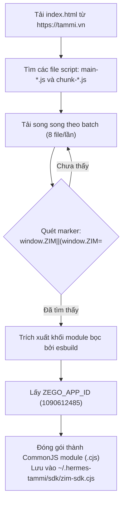
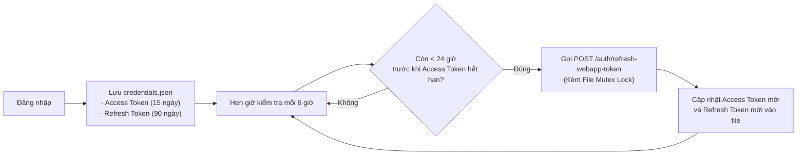

# 05. Cơ Chế Trích Xuất SDK & Hướng Dẫn Xác Thực

Do Viettel không phát hành gói npm công khai cho SDK của Tammi, hệ thống sử dụng giải pháp **trích xuất tự động SDK trực tiếp từ trang web chính thức** và triển khai cơ chế xác thực phiên bền bỉ (Persistent Authentication).

---

## 1. Cơ Chế Tự Động Trích Xuất SDK (`sdkFetcher`)

SDK ZIM của Tammi được nhúng bên trong các bundle JavaScript của trang `https://tammi.vn`. Mô-đun `bridge/sdkFetcher.js` thực hiện các bước sau:



### Hỗ trợ Trích xuất từ file HAR (Trường hợp không có mạng hoặc mạng nội bộ):
Người dùng có thể xuất file `.har` từ tab Network của trình duyệt và chạy lệnh:
```bash
hermes-tammi-plugin fetch-sdk --har /path/to/tammi.vn.har
```

---

## 2. Ba Phương Thức Đăng Nhập (Authentication Methods)

### Phương thức 1: Trích xuất Phiên từ Trình duyệt (Khuyên dùng)
Vì `tammi.vn` sử dụng Cloudflare Turnstile để chặn bot tự động gửi OTP, cách tin cậy và an toàn nhất là lấy phiên từ trình duyệt đã đăng nhập.

1. Đăng nhập tài khoản trên [tammi.vn](https://tammi.vn) qua trình duyệt Chrome hoặc Edge.
2. Bấm phím `F12` (hoặc `Ctrl + Shift + I` / `Cmd + Option + J`) để mở Developer Tools.
3. Chọn tab **Console**, nhập `allow pasting` nếu trình duyệt yêu cầu, sau đó dán đoạn mã sau và nhấn Enter:
   ```javascript
   copy(JSON.stringify({
     token: localStorage.token,
     refresh_token: localStorage.refresh_token,
     device_id: localStorage.device_id
   }))
   ```
4. Dán chuỗi JSON đã sao chép vào công cụ dòng lệnh hoặc gửi qua API `importSession`.
5. **Lưu ý quan trọng**: Đóng tab trình duyệt lại, **tuyệt đối không bấm nút "Đăng xuất"** trên trình duyệt vì thao tác đó sẽ làm vô hiệu hóa refresh token trên máy chủ Tammi.

---

### Phương thức 2: Đăng nhập bằng Số điện thoại + Mật khẩu
Chỉ áp dụng khi tài khoản đã được thiết lập mật khẩu trong ứng dụng di động Tammi:
```bash
hermes-tammi-plugin login --password
```
Quy trình:
1. Gọi `GET /user/check-user-exist?username=<phone>`.
2. Lấy IP máy khách từ `api.ipify.org`.
3. Gọi `POST /auth/login-password` với `username` và `password`.

---

### Phương thức 3: Đăng nhập bằng Mã OTP SMS (Nâng cao)
Cần có mã xác thực Cloudflare Turnstile token (`cf-token`):
```bash
hermes-tammi-plugin login --otp --cf-token <token>
```
Quy trình:
1. Gọi `POST /auth/request-otp` kèm header `cf-token`.
2. Người dùng nhập mã OTP 6 số nhận từ tin nhắn SMS.
3. Gọi `POST /auth/login-webapp-otp` kèm `Os-Type: web`.

---

## 3. Vòng Đời Token & Cơ Chế Giữ Phiên Bền Vững (Keep-Alive)



### Quy tắc Gia hạn & Tuổi thọ Token:
1. **Access Token**: Hạn dùng 15 ngày ($1,296,000$ giây).
2. **Refresh Token**: Hạn dùng 90 ngày ($7,776,000$ giây). Mỗi lần gọi API refresh, Tammi sẽ **cấp mới một refresh token khác** (Refresh Token Rotation) và làm mới chu kỳ 90 ngày.
3. **Bridge Tự Động Gia Hạn**: Bridge chủ động gọi refresh trước hạn 1 ngày (`REFRESH_MARGIN_SEC = 24 * 3600`). Nhờ đó, chỉ cần Bridge hoạt động ít nhất một lần trong vòng 3 tháng, phiên đăng nhập sẽ được duy trì vĩnh viễn mà không bao giờ phải đăng nhập lại.
4. **ZEGO Chat Token**: Có hạn 24 giờ, SDK tự động bắn sự kiện `tokenWillExpire` để Bridge gọi `POST /meeting/zego/token` lấy token mới và gia hạn qua `zim.renewToken(token)`.

---

## 4. Cơ Chế Khóa File Tránh Xung Đột (File Mutex Lock)

File lưu thông tin phiên `credentials.json` được dùng chung giữa Bridge chạy nền và các lệnh CLI (`hermes-tammi-plugin status`, `login`, `setup`...).

Để ngăn chặn Race Condition (hai tiến trình cùng làm mới token một lúc dẫn đến refresh token cũ bị hủy trên server):
- Triển khai file lock: `credentials.json.lock` bằng cờ mở file độc quyền `fs.openSync(lock, "wx")`.
- Thời gian chờ lock tối đa (`LOCK_WAIT_MS`): 15 giây.
- Thời gian tự hủy lock bị treo (`LOCK_STALE_MS`): 30 giây.
- Quyền truy cập tệp luôn được giới hạn an toàn ở mức `0600` (chỉ người dùng hiện tại có quyền đọc/ghi).
